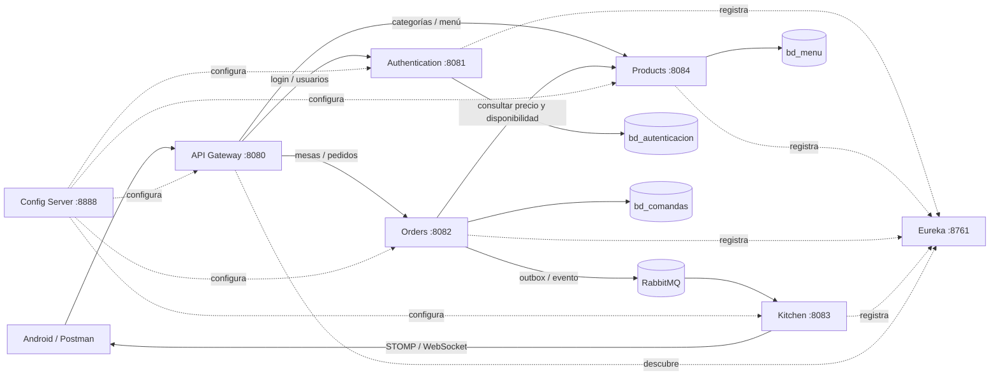

# Arquitectura y relaciones - Wendy's Food

## Componentes

- `infrastructure/api-gateway` (8080): entrada pública, valida JWT y enruta.
- `infrastructure/eureka-server` (8761): registro y descubrimiento.
- `infrastructure/config-server` (8888): sirve configuración central desde `classpath:/configs`.
- `microservice/authentication-service` (8081): usuarios y roles; BD `bd_autenticacion`.
- `microservice/products-service` (8084): menú, categorías y productos; BD `bd_menu`.
- `microservice/orders-service` (8082): mesas, comandas y eventos; BD `bd_comandas`.
- `microservice/kitchen-service` (8083): consumo RabbitMQ y WebSocket/STOMP.

## Flujo de red

## Rutas principales conservadas

| Ruta pública | Destino |
|---|---|
| `/api/v1/autenticacion/**` | authentication-service |
| `/api/v1/administracion/**` | authentication-service |
| `/api/v1/menu/**` | products-service |
| `/api/v1/mesas/**` | orders-service |
| `/api/v1/pedidos/**` | orders-service |
| `/api/v1/cocina/**` | orders-service |
| `/ws/cocina/**` | kitchen-service |

## Separación de datos

`products-service` es propietario de categorías/productos. `orders-service` no consulta tablas de otra base: solicita el producto por HTTP al catálogo y persiste en cada línea el identificador, nombre y precio unitario utilizados en ese pedido. Esto conserva la información histórica incluso si el producto cambia de precio posteriormente.
